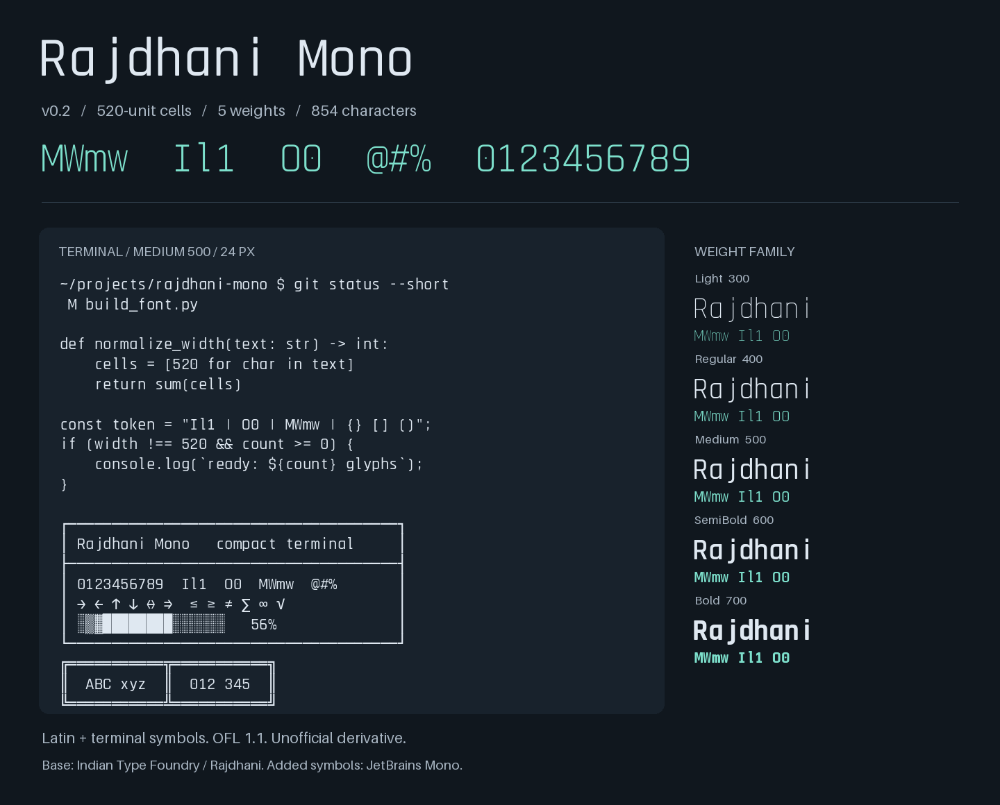
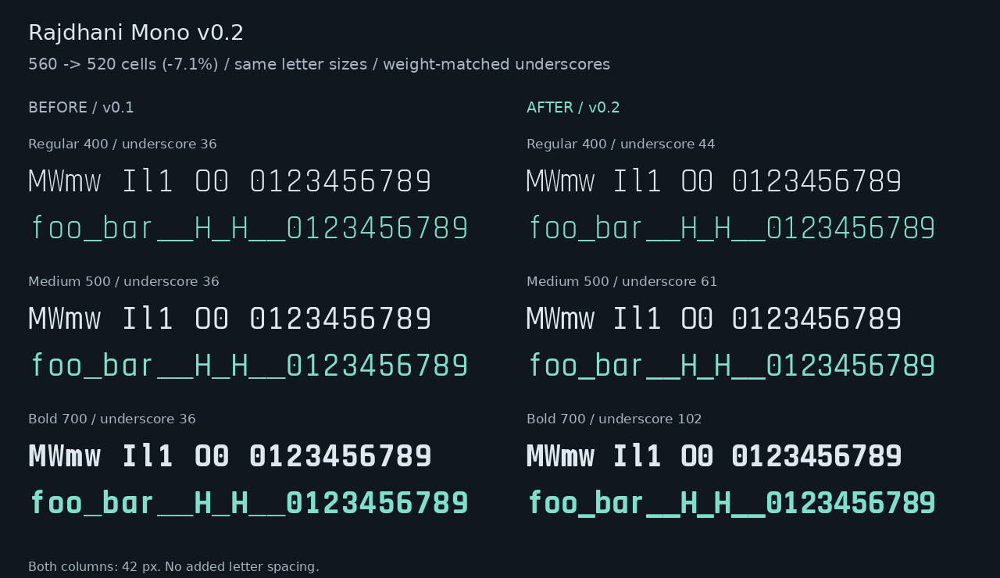

# Rajdhani Mono

[中文](README.md) · [Font files](fonts/ttf) · [License](LICENSE)

Rajdhani Mono is an unofficial monospace derivative of [Rajdhani](https://github.com/itfoundry/rajdhani), made for terminals and code editors. It preserves the original typeface's condensed, squared shapes, rounded corners, and flat stroke endings.

Current version: **v0.2**. Font software and build recipes are distributed under the **SIL Open Font License 1.1**.



## Install

Download or clone the repository and install the five TTF files in [`fonts/ttf/`](fonts/ttf). Select **Rajdhani Mono** in your terminal or editor. **Medium 500** is a useful starting point; some applications expose it as the separate **Rajdhani Mono Medium** family.

- Windows: select the TTF files and choose Install from the context menu.
- macOS: open the files in Font Book and install them.
- Linux: run the following commands from the repository root, then reopen your application's font picker.

```sh
mkdir -p "${XDG_DATA_HOME:-$HOME/.local/share}/fonts/RajdhaniMono"
cp fonts/ttf/*.ttf "${XDG_DATA_HOME:-$HOME/.local/share}/fonts/RajdhaniMono/"
fc-cache -f
```

Replace an installed v0.1 copy and restart your terminal or editor to load v0.2.

Download [`docs/preview.html`](docs/preview.html) and open it locally for an offline specimen with adjustable weight, size, background, and text. All fonts are embedded. GitHub's file viewer shows the HTML source. Webfonts are provided in [`fonts/woff2/`](fonts/woff2).

## Family and coverage

Five weights are included: **Light 300, Regular 400, Medium 500, SemiBold 600, and Bold 700**.

Each weight contains **854 encoded characters**, including ASCII, the original font's Latin extensions, punctuation, selected mathematical symbols, arrows, all box-drawing and block-element characters, and eight Powerline symbols.

- Printable encoded characters advance by **520/1000 em**; combining accents and zero-width controls do not occupy another cell.
- `I`, `l`, and `1` have distinct structures; `0` has a centre dot.
- Narrowing `m` and `M` preserves their upright stem thicknesses.
- Underscores span the full cell and follow the weight's horizontal stroke thickness.
- No kerning or programming ligatures change code-column alignment.
- Fourteen combining accents are positioned, and the Romanian `Ț/ț` pair is added.

## Changes in v0.2

The cell width is reduced from **560 to 520**, approximately **7.1%**. Minimum side margins shrink from 40 to 20 units while the maximum Latin outline width remains 480, preserving letter sizes.

The v0.1 underscore was fixed at 36 units for every weight. It now measures **30 / 44 / 61 / 80 / 102** units for Light / Regular / Medium / SemiBold / Bold. Text-decoration thickness metadata is updated as well.



Download [`docs/comparison.html`](docs/comparison.html) to compare both versions at the same size and weight.

## Current limitations

This is an early usable release, validated with Linux font tools, FreeType, and HarfBuzz. Windows, macOS, and individual terminal applications have not yet been tested.

- CJK, Devanagari, full Greek/Cyrillic coverage, italics, and variable fonts are not included.
- Eight Powerline symbols do not constitute a full Nerd Font icon set; missing characters depend on application fallback.
- Common single-layer accents above and below letters are supported; stacked accents need further work.
- Light can be faint at small sizes. `W/w` and exceptionally wide symbols still benefit from manual refinement.
- Box drawing uses the default line metrics. Extra terminal line spacing introduces vertical gaps.

## Build

Python 3.10+ is required; **Python 3.12** is recommended. Pinned upstream fonts, licenses, commits, and SHA-256 hashes are included in [`sources/`](sources/manifest.json). Font building does not download upstream assets.

```sh
python -m venv .venv
.venv/bin/python -m pip install -r requirements.txt
.venv/bin/python scripts/build_font.py
.venv/bin/python scripts/make_preview.py
```

On Windows, replace `.venv/bin/python` with `.venv\Scripts\python.exe`.

Final fonts are written to `fonts/`, intermediate files to the ignored `build/` directory, and build summaries to `reports/`. `make_preview.py` updates the current font specimen and size checks; historical comparison files remain separate.

## Validate and package

```sh
.venv/bin/python scripts/validate_font.py
.venv/bin/python scripts/check_rebuild.py
.venv/bin/python scripts/package_release.py
```

Checks include character metrics, actual text shaping, accent placement, upright-stem preservation, terminal cell edges, WOFF2 round trips, and rendering every encoded character at 12, 16, 20, and 32 px. Rebuilding compares all five TTF and five WOFF2 files byte-for-byte.

With Fontconfig and OpenType Sanitizer installed, run:

```sh
.venv/bin/python scripts/validate_font.py --require-fontconfig --ots ots-sanitize
```

Without `fc-scan`, the default validation skips that check and records `null`; `--require-fontconfig` instead treats its absence as an error.

The [GitHub Actions workflow](.github/workflows/fonts.yml) validates, rebuilds, and packages the fonts on pushes and pull requests. Release archives in `dist/` contain fonts, provenance, recipes, documentation, licenses, and checksums. Attach the ZIP and its `.sha256` file to a GitHub Release, using a tag such as `v0.2`. Releases and websites are not automatically published.

## Credits and license

Latin outlines come from Indian Type Foundry's Rajdhani through its [Google Fonts distribution](https://github.com/google/fonts/tree/main/ofl/rajdhani). Additional terminal, arrow, and mathematical outlines come from [JetBrains Mono](https://github.com/JetBrains/JetBrainsMono); its Latin letters and programming ligatures are not incorporated.

Pinned revisions:

- Google Fonts / Rajdhani: `8772f86137e17678cbd3584ca9a3c9486c3e7e50`
- JetBrains Mono: `19371302b95d218af43299bce79ddbddd0bc364d`

Upstream licenses remain in their respective source directories. Font software and recipes use [SIL OFL 1.1](LICENSE); full notices are in [NOTICE.txt](NOTICE.txt). This project is unofficial and is not endorsed by Indian Type Foundry or JetBrains.

See [CONTRIBUTING.md](CONTRIBUTING.md) for feedback and contribution guidance, and [CHANGELOG.md](CHANGELOG.md) for release history.
